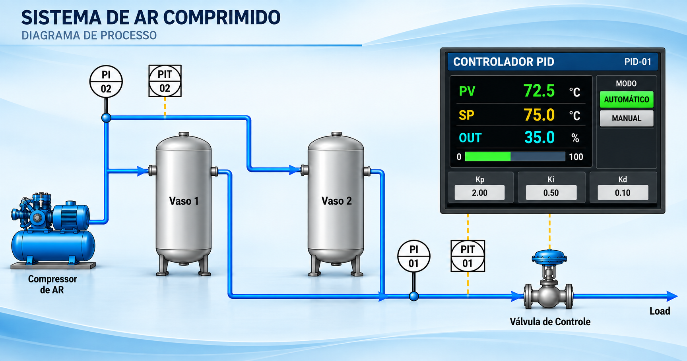

# Estudo de Caso para Identificação de Sistemas Não Lineares em Processos de Pressão Industrial: Dataset Aberto e Modelagem MISO NARX/ARX

<div align="center">

[](./paper/main.tex)
[](https://www.python.org/)
[](https://www.mathworks.com/)
[](https://www.elipse.com.br/)
[](https://www.rockwellautomation.com/)
[](./LICENSE)

**Pontifícia Universidade Católica do Paraná (PUCPR)**  
*Programa de Pós-Graduação em Engenharia / Automação e Sistemas*

**Autores:** Matheus Kale Mendes, Fabricio Cassanho Teodoro, Gabriel Tartari, Helon Vicente Hultmann Ayala

</div>

---

## 📌 Sumário Executivo

Este repositório disponibiliza um **benchmark experimental e computacional aberto para Identificação de Sistemas Não Lineares** baseado em uma planta industrial de controle de pressão de ar comprimido. O projeto abrange desde a engenharia de controle em nível de campo (CLP Allen-Bradley e supervisório Elipse E3 SCADA) até a formulação matemática avançada de identificação de caixas-pretas (*black-box system identification*), comparando modelos lineares **ARX** e não lineares polinomiais **NARX** em estrutura **MISO** (*Multiple-Input Single-Output*).

Os dados e resultados aqui apresentados subsidiam o artigo científico submetido para conferência internacional **IFAC** (*International Federation of Automatic Control*):  
📄 *"A case study for nonlinear system identification of pressure control systems"*.

> 📖 **Documentação Complementar:**  
> - Para uma explicação aprofundada da física do processo, do CLP e da automação: consulte [Como Funciona Tudo](COMO_FUNCIONA_TUDO.md).  
> - Para instruções de injeção de sinais arbitrários na IHM: consulte o [Guia de Execução de Sinal CSV no Elipse E3](Guia_Execucao_CSV_Matlab.md).

---

## 🏭 A Bancada Experimental

A bancada física é composta por um vaso metálico de pressão alimentado por uma linha de ar comprimido industrial regulada por uma válvula de controle proporcional com atuador eletropneumático.

<div align="center">
  
  <p><em>Figura 1: Diagrama esquemático de tubulações, instrumentação e instrumentação da bancada de pressão da PUCPR.</em></p>
</div>

### Variáveis do Processo (Configuração MISO)
O sistema é modelado como um processo de duas entradas e uma saída:

| Variável | Notação | Unidade | Descrição do Instrumento / Função |
| :--- | :---: | :---: | :--- |
| **`PV_OUT`** | $y(k)$ | psi | **Saída do Sistema:** Pressão medida no interior do vaso de pressão (sensor piezorresistivo a jusante). |
| **`CV`** | $u_1(k)$ | % | **Entrada Exógena 1:** Variável de controle enviada à válvula proporcional (0% = fechada, 100% = aberta). |
| **`PV_IN`** | $u_2(k)$ | psi | **Entrada Exógena 2:** Pressão da linha de suprimento de ar comprimido a montante da válvula (perturbação dinâmica da rede). |

### Desafios Não Lineares do Processo
1. **Compressibilidade dos Gases:** Relações não lineares de densidade, temperatura e pressão em escoamentos de ar;
2. **Vazão por Orifício em Função da Pressão a Montante:** A vazão mássica através do obturador da válvula depende fortemente do termo acoplado $(PV_{IN} - PV_{OUT})$;
3. **Assimetria Temporal:** O enchimento do vaso é forçado pela alta pressão da linha (subida rápida), enquanto o esvaziamento depende da despressurização natural do vaso pela restrição de saída (descida lenta);
4. **Histerese e Atrito:** Não linearidades intrínsecas ao posicionador da válvula.

---

## 📊 Dataset Experimental Oficial (Padrão-Ouro)

O ensaio oficial de identificação e validação dinâmica do sistema é o **`Random Steps_3.csv`**, sintetizado no MATLAB com degraus pseudo-aleatórios e executado pelo supervisório Elipse E3 com taxa de amostragem síncrona de 4 Hz.

- **Arquivo:** [`data/Random Steps_3.csv`](./data/Random%20Steps_3.csv) (ou espelhado em [`IHM_Press_V3/.../RESULTADOS/`](./IHM_Press_V3/IHM_Press_V3/IHM_Press/RESULTADOS/Random%20Steps_3.csv))
- **Taxa de Amostragem ($T_s$):** $0{,}25$ s (250 ms) $\rightarrow$ Frequência: 4 Hz
- **Total de Amostras:** 5.871 pontos ($\approx 24{,}5$ minutos de ensaio ininterrupto)
- **Protocolo de Validação:**
  - **Treinamento (50% Inicial):** Primeiros 12,2 minutos (2.935 amostras) usados para estimativa dos parâmetros;
  - **Teste (50% Final):** Últimos 12,3 minutos (2.936 amostras) reservados exclusivamente para teste em dados nunca vistos.

<div align="center">
  
  <p><em>Figura 2: Dados do ensaio experimental oficial (Random Steps 3): sinais de entrada (CV e PV_IN) e resposta da pressão no vaso (PV_OUT) divididos em Treino (50%) e Teste (50%).</em></p>
</div>

---

## 🔬 Resultados Científicos e Modelagem

Os modelos foram estimados utilizando **Ortogonalização por Gram-Schmidt Modificado (MGS)** combinada com o algoritmo **FROLS** (*Forward Regression Orthogonal Least Squares*) e seleção de regressores orientada pelo critério de **Taxa de Redução do Erro (ERR)**.

### Tabela Comparativa de Desempenho (RMSE em psi)

| Modelo | Grau Polinomial ($\ell$) | Regressores | Treino OSA | Treino Free-Run | Teste OSA | Teste Free-Run | Redução de Erro no Teste |
| :--- | :---: | :---: | :---: | :---: | :---: | :---: | :---: |
| **ARX Linear** | $\ell = 1$ | 6 | 0.1584 | 1.7877 | 0.1231 | 4.9262 | *Referência* |
| **NARX Não Linear** | $\ell = 3$ | 8 | 0.1335 | 0.3729 | **0.0934** | **1.2115** | **-75,4% de erro** |

*OSA: One-Step-Ahead (Predição um passo à frente) \| Free-Run: Simulação livre recursiva em malha aberta (sem realimentação dos dados medidos).*

---

### Modelo Linear ARX ($\ell = 1$)
Equação identificada:
```text
y(k) = 0.9885 y(k-1) 
     + 5.25e-04 CV(k-1) 
     + 2.42e-03 CV(k-3) 
     + 3.94e-02 PV_IN(k-1) 
     - 4.31e-02 PV_IN(k-2) 
     + 0.4378
```

<div align="center">
  
  <p><em>Figura 3: Modelo linear ARX nos dados de teste: a simulação livre (Free-Run) desvia-se significativamente da medição real ao longo do tempo (RMSE = 4.9262 psi).</em></p>
</div>

---

### Modelo Não Linear NARX Polinomial ($\ell = 3$)
Equação identificada pelo algoritmo FROLS:
```text
y(k) = 0.5615 y(k-1) 
     + 0.4249 y(k-3) 
     + 2.60e-04 CV(k-3) * PV_IN(k-2) 
     - 1.86e-06 CV(k-3) * PV_IN²(k-1) 
     - 1.83e-06 y(k-1) * CV²(k-3) 
     + 1.66e-07 PV_IN³(k-3) 
     + 1.69e-06 y(k-3) * CV(k-1) * PV_IN(k-3) 
     - 2.02e-06 y³(k-3)
```

<div align="center">
  
  <p><em>Figura 4: Modelo não linear NARX nos dados de teste: excelente aderência tanto em subidas rápidas quanto nos esvaziamentos lentos (RMSE em Free-Run cai para 1.2115 psi).</em></p>
</div>

> **Interpretação Física:** O algoritmo selecionou automaticamente produtos cruzados como $CV(k-3) \cdot PV_{IN}^2(k-1)$, evidenciando a dependência do fluxo mássico da válvula em relação à pressão de suprimento e capturando os efeitos de compressibilidade que o modelo linear não consegue representar.

---

## 🗂️ Estrutura e Organização dos Dados

Para garantir transparência científica, os arquivos de ensaios estão divididos entre ativos, sinais de excitação e histórico:

```
pressure-plant-case-study/
│
├── data/                                # Datasets consolidados e sinais prontos
│   ├── Random Steps_3.csv               # ⭐ DATASET OFICIAL (Golden Standard, 4 Hz, 24,5 min)
│   ├── sinal_degraus_aleatorios.csv     # Sinal gerado no MATLAB para excitação
│   ├── sinal_semi_estatica.csv          # Sinal de rampa ascendente/descendente
│   └── sinal_swept_sine.csv             # Sinal de chirp em frequência
│
├── IHM_Press_V3/                        # Automação Industrial, CLP e SCADA
│   └── IHM_Press_V3/IHM_Press/
│       ├── Planta_PUC_Press.ACD         # Programa Ladder do CLP Allen-Bradley (Studio 5000)
│       ├── IHM_Temp.prj / .dom          # Projeto e domínio do Supervisório Elipse E3
│       └── RESULTADOS/                  # Pasta oficial de exportação da bancada
│           ├── Random Steps_3.csv/.xlsx # Ensaio ativo padrão do artigo
│           ├── plotar_dados.py          # Script de plotagem rápida de curvas
│           └── OBSOLETOS/               # 📦 Ensaios anteriores arquivados
│               ├── Random Steps_1 / 2   # Ensaios de calibração preliminares
│               ├── Shirp_1              # Ensaio preliminar com chirp
│               └── TESTE1_SENO          # Validação preliminar senoidal
│
├── scripts/                             # Algoritmos de modelagem e identificação
│   ├── arx_miso.py                      # Estimação e validação do modelo linear ARX MISO
│   ├── narx_miso.py                     # Pipeline de treinamento e validação NARX MISO
│   ├── miso_narx.py                     # Classe e algoritmo FROLS com critério ERR
│   ├── gerar_sinais_excitacao_pressao.m # Script MATLAB de síntese dos sinais
│   └── antigos/                         # Scripts de iterações iniciais
│
├── images/                              # Figuras, gráficos e diagramas
├── paper/                               # Código-fonte LaTeX do artigo IFAC
│   ├── main.tex                         # Artigo IFAC
│   └── fig/                             # Figuras de alta resolução incluídas no artigo
│
├── raw_data/                            # Registros legados de amostragem lenta (1 Hz)
├── COMO_FUNCIONA_TUDO.md                # 📘 Manual técnico e arquitetura completa
└── Guia_Execucao_CSV_Matlab.md          # 📗 Guia de execução de CSVs no Elipse E3
```

---

## 🚀 Como Executar e Reproduzir os Resultados

### Pré-requisitos
- Python 3.10 ou superior
- Bibliotecas: `numpy`, `pandas`, `matplotlib`, `scipy`
- MATLAB (opcional, apenas se desejar sintetizar novos sinais de excitação)

### 1. Clonar o Repositório
```bash
git clone https://github.com/Matheus2091/pressure-plant-case-study.git
cd pressure-plant-case-study
```

### 2. Instalar Dependências do Python
```bash
pip install numpy pandas matplotlib scipy
```

### 3. Reproduzir o Modelo Linear ARX MISO
```bash
python scripts/arx_miso.py
```
*O script carrega automaticamente o dataset `Random Steps_3.csv`, realiza a divisão 50/50 treino/teste, executa a ortogonalização OLS, exibe a equação no terminal e plota os gráficos comparativos de One-Step-Ahead e Free-Run.*

### 4. Reproduzir o Modelo Não Linear NARX MISO (FROLS)
```bash
python scripts/narx_miso.py
```
*O script executa o algoritmo FROLS de grau $\ell=3$, ranqueia os 8 termos mais relevantes pelo critério ERR, gera a equação não linear e plota a simulação livre superposta aos dados medidos.*

### 5. Inspecionar Qualquer Arquivo de Dados Rapidamente
```bash
python IHM_Press_V3/IHM_Press_V3/IHM_Press/RESULTADOS/plotar_dados.py "Random Steps_3.csv"
```

---

## 📑 Como Citar este Trabalho

Se este repositório, dataset ou código forem úteis para a sua pesquisa, por favor cite o artigo de referência:

```bibtex
@inproceedings{mendes2026pressure,
  author    = {Matheus Kale Mendes and Fabricio Cassanho Teodoro and Gabriel Tartari and Helon Vicente Hultmann Ayala},
  title     = {A case study for nonlinear system identification of pressure control systems},
  booktitle = {Proceedings of the IFAC Conference},
  year      = {2026},
  address   = {Curitiba, Brazil},
  note      = {Dataset and implementation available at: https://github.com/Matheus2091/pressure-plant-case-study}
}
```

---

## 📜 Licença

Este projeto está licenciado sob a Licença MIT - consulte o arquivo [LICENSE](./LICENSE) para mais detalhes.
